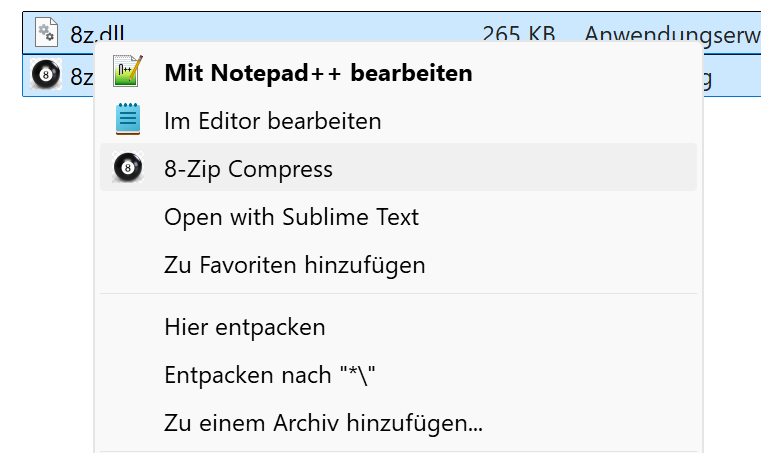
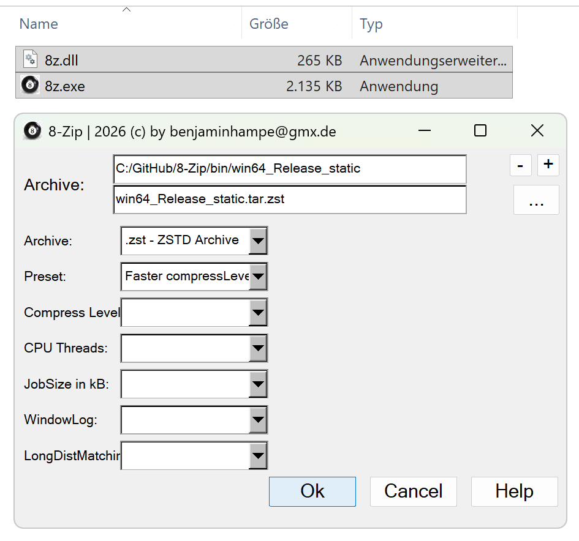
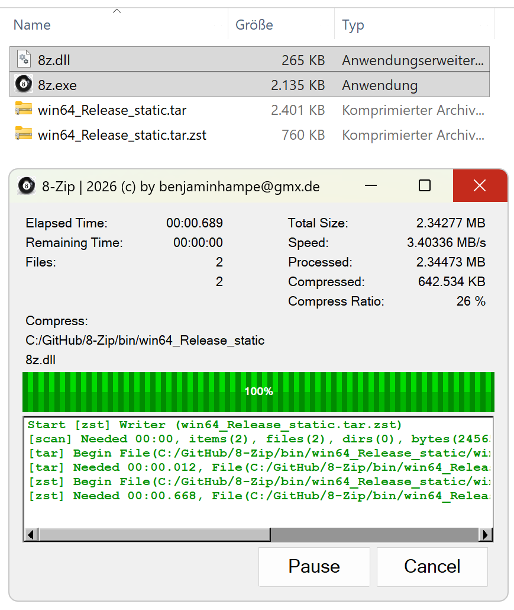

# 8-Zip
8-Zip

7-Zip clone to compress *.zst, *.tar, support for new *.bzip3 is planned.

No decompression yet, just a matter of time.

Uses fltk-1.4.5 as platform independent GUI.

It is planned to support Linux, so far Windows only.

# Capabilities:

+ Integrates into Window Explorer Context Menu and offers menu items for compression

+ Supports *.tar and *.zst files.

+ Lib ZSTD was compiled with multithreading support and has a fix preset so far, compressionLevel 19 of 22.

+ The TAR lib is my own writing. I had to figure TAR out because Zstd has no idea of folders and files.

to compress something to ZSTD you either give exactly one file, or compress all to TAR first and then 

give it to ZSTD. That TAR issue kinda took a while. Used longlink first for long paths, not PAX header like 7zip.

+ TAR inspector accessible over commandline. Used it to inspect TAR files created by 7-zip and understand the format.
 
# History:

+ ShellExtension dll became necessary because Windows Explorer has no common action for multiselected files and folders.

Without the extension .dll explorer would start 8z once for files and once for folders, which is unwanted behaviour.

+ The old ShellExtension interface has also issues like a hard limit of 16 selected items, which 

wasn't good enough for big selections to be compressed into a single archive.

+ Trying to circumvent the limitation using the old stuff did not work. Much time wasted.

+ Also giving selection lists over registry commands is prone to middle attacks.

+ Also the old approach needed Admin Rights to install correctly.

# Current:

+ The current approach uses the newer IExplorerCommand interface.

+ Does not need Admin Rights to install the actions into context menu of explorer, very nice.

- No solution yet for finding the correct explorer tab. 

Newer Windows Explorer has ability to open multiple tabs but did not account API to access 
the current tab. Technical debt replaced with new technical debt. Typical Microsoft.

# HowTo:

## Select files and folders

## Click right mouse button to open explorer context menu and choose 8z Compress

## Compression Dialogue

